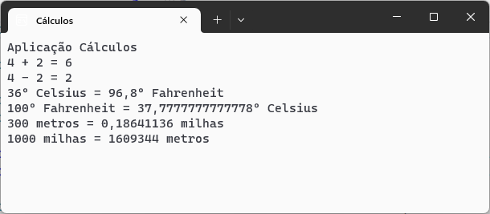

# calculos :1234:
Aplicação C# para realizar vários diversos calculos

Desenvolvido no ambito da ação de formação de **Introdução ao Git e Github**

## Operações Suportadas

Neste momento, esta aplicação implementa as seguintes operações:

- soma
- subtração
- conversão de temperaturas
   -   celsius :arrow_right: fahrenheit
   -   fahrenheit :arrow_right: celsius

- conversão de distancias
       - metros  :arrow_right: milhas
       - milhas  :arrow_right: metros

## Tecnologias utilizadas neste projeto

- Visual Studio
- C#
- Github Desktop
- Plataforma Github

